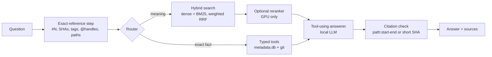

# repo-rag

A developer companion that indexes a GitHub repository and answers questions about it, with
citations. It handles architecture questions, code explanations, bug report to past fix
matching, and exact questions about history, people, PRs, issues and releases.

What sets it apart is **AST-based chunking** (tree-sitter): functions, methods and classes stay
whole instead of being cut at a character count. Every claim in this file is backed by a
measurement in [`eval/RESULTS.md`](eval/RESULTS.md) or [`docs/PROJECT_LOG.md`](docs/PROJECT_LOG.md),
and the limits are stated next to the numbers.

Only **open-source local models** are used. Nothing needs an Anthropic or OpenAI key.

## How it works



- **Questions about meaning** ("how does auth reach the DB?") go to hybrid search over code,
  docs, commits, PRs and issues: Qwen3 embeddings fused with BM25 by weighted reciprocal-rank
  fusion, always filtered by repo.
- **Exact questions** (who, when, how many, `#1234`, SHAs, tags) go to typed, parametrized tools
  over `metadata.db` (SQLite) and git. The model never writes SQL and never estimates names,
  dates or counts: it quotes tool output.
- **Every answer is checked.** Citations (`path:start-end` for code, short SHA for commits) are
  validated against what the tools actually returned; invalid ones are removed and unverified
  commit ids are flagged in the UI.

### Where the work runs

| Where | What |
|---|---|
| Laptop (CPU, no GPU needed) | Retrieval, tools, citation check, API, Streamlit UI |
| Colab A100 40 GB | Indexing (embedding is about 0.16 chunks/s on a laptop CPU), the answer model, the reranker |

Indexes move between machines as plain data (`export-index` / `import-index`), not Chroma
files. The answer model is served from Colab over a hash-checked Cloudflare tunnel; prompts cross
a public tunnel, so use it with **public repositories only**. The API has no authentication:
run it on localhost.

## Quickstart

```bash
uv sync
cp .env.example .env    # set GITHUB_TOKEN for PR/issue sync; never commit .env
uv run repo-rag --help
uv run pytest -q        # offline suite; network tests are deselected
```

Index a repository on a GPU, then use it on the laptop:

1. Open `notebooks/index_on_colab.ipynb` in Colab (A100), set the repo, run it, and download the zip.
2. Import it:

```bash
uv run repo-rag import-index repo_rag_index.zip
```

3. Search without any LLM:

```bash
uv run repo-rag search "where are retries configured" --repo psf/requests
```

4. For answers, start the model server with `notebooks/serve_model_on_colab.ipynb` (it releases
   the GPU after 10 idle minutes), then start the API and UI and paste the URL and token:

```bash
uv run uvicorn repo_rag.api.server:app --reload
uv run streamlit run src/repo_rag/ui/app.py
```

Later, bring an indexed repo up to its latest commit. Chunks whose text did not change keep their
vectors (even if they moved to other lines); `--dry-run` shows how many would be embedded first, and
embedding more than 200 chunks on this machine needs `--yes` (use Colab for big updates):

```bash
uv run repo-rag update <owner/repo> --dry-run
uv run repo-rag update <owner/repo>
```

PR and issue data for the exact-fact tools:

```bash
uv run repo-rag sync-github <owner/repo> --max-prs 100000 --max-issues 100000
```

More commands (symbols, callers, summaries, history, eval runs) are listed in [CLAUDE.md](CLAUDE.md).

## Measured results

All numbers are from this repository's own eval harness. "Exploratory" means no pre-registered
gate and a single repository; read the caveats before quoting any of them.

### AST chunking: more complete evidence, not a consistent ranking gain

Exact dense search, headers on, 40 questions per repo, fraction of gold line ranges that
reach 90% coverage in the top 10 ("Gold ≥90%@10"):

| Repo | Character chunks | Language-aware splitter | AST (ours) |
|---|---:|---:|---:|
| psf/requests | 0.654 | 0.625 | **0.842** |
| expressjs/express | 0.725 | 0.725 | **0.825** |

AST minus character, headers on, all questions: +0.188 [+0.085, +0.292] on Requests and +0.100
[+0.000, +0.225] on Express (paired bootstrap, 95% CI). Ranking (MRR@10) is **not** consistently
better, and in some hybrid settings it is worse (Requests −0.074 [−0.137, −0.017]). The reference
`astchunk` library matches our completeness on Requests (0.842 both), so this does not show an
advantage over reference cAST. Python and JavaScript only; two repos.

### Embedding model

`Qwen/Qwen3-Embedding-0.6B` at 512 dimensions, chosen by comparing it with a 7B code embedder, CodeRankEmbed and BM25 (nDCG@10):

| Task | Qwen3-0.6B @512d | nomic-embed-code 7B | BM25 |
|---|---:|---:|---:|
| Questions about code (36) | 0.738 | 0.431 | 0.522 |
| Bug report → fix commit (144) | 0.482 | 0.596 | 0.347 |

The 7B model wins bug-to-fix but would need a GPU at query time and a much larger index, so it
was not adopted. Filtering retrieval by repo adds 0.13 to 0.18 nDCG@10 for every model.

### Reranking (opt-in, GPU only)

- **Code**: `Qwen3-Reranker-8B` beat the 4B on 150 questions: MRR 0.860 → 0.926 (+0.066
  [+0.026, +0.109]), at about +45% latency.
- **Bug report → fix commit**, held-out test, 8B rerank at depth 50:

| Repo | n | Hit@5 | MRR@10 |
|---|---:|---:|---:|
| psf/requests | 113 | 0.858 | 0.770 |
| pallets/flask | 136 | 0.978 | 0.933 |
| fastapi/fastapi (via PR links) | 14 | 0.857 | 0.857 |
| all | 263 | 0.920 | 0.859 |

Without reranking, source-path Hit@5 is 0.779 (requests 0.689, flask 0.850). The gold here is
link-derived (an issue's own fix commit), so this does not measure how useful *similar* past
fixes are to a developer.

### Exact facts through the agent

60 auto-generated facts on encode/httpx (expected answers from the raw GitHub data and plain git):
**60/60** through the tools alone, and **59/60 (98.3%)** through the local model (target 90%).
The one miss is a right commit with the SHA shortened to 10 characters instead of 12; the check
was not loosened. This scores routing among the exact tools, not retrieval.

### End-to-end agent check (exploratory)

103 questions on psf/requests through the real agent with `Qwen2.5-Coder-14B-Instruct` on an
A100, single deterministic runs (three passes were identical), no gates:

| Question type | Pass |
|---|---:|
| Code (40) | 35/40 baseline prompt, 36/40 default prompt |
| Docs (12) | 7/12 baseline prompt, 10/12 default prompt |
| History (11) | 11/11 |
| References `#N` (10) | 10/10 |
| Kind of `#N` (5) | 5/5 |
| Issue → fixing PR (10) | 10/10 |
| Out-of-scope probes (5) | 5/5 (correctly abstained) |
| **Bug report → fix commit (10)** | **3/10** |

The default prompt (`docs_hint_narrow`) was measured on code, docs and PR search only (62
questions); the other rows come from the baseline-prompt run. On 10 fresh docs-style questions
it routed 9/10 to docs search against 1/10 for the baseline, with code unchanged at 8/10.

### Answer quality (code and docs answers, AI-checked)

The pass rates above are mechanical (the cited lines overlap the known answer). A local judge,
`Qwen3.8-27B` (4-bit), read the 50 non-abstained code and docs answers against the lines they cite
and a reference. Its negative controls (an answer paired with another question's evidence) were
rejected 98% to 100% of the time, so it can tell a wrong answer from a right one. Rates:

| Reader | Faithful (claims supported by cited lines) | Correct |
|---|---:|---:|
| Judge, v2 prompts | 25/48 (52%) | 41/50 (82%) |
| AI review (Codex, corrected by a second AI reader) | 30/50 (60%) | 33/50 (66%) |

Read these as ranges, not accuracy: the mechanical pass rate overstates quality (42 answers pass,
12 of them are partial or worse in the review), the judge is kinder than the review on completeness, and
**no independent human labels exist** (the marks on a 15-answer hard-case sample were
unverified). Details and the judge's failure patterns: [docs/PROJECT_LOG.md](docs/PROJECT_LOG.md).

**Commit questions are the weak spot.** Diagnosis showed the limit is retrieval ranking, model
selection and abstention, not query drift, and none of the switches tried gave a clear gain.
Treat answers to "which past commit fixed this?" as leads to check, not conclusions.

## Known limits

- **One main repository.** Almost every number is from `psf/requests` (plus httpx for exact
  facts, Flask and FastAPI for commit search). Other languages, larger repos and ANN accuracy at
  scale are unmeasured.
- **Labels are author-checked.** Independent human review of the architecture labels is pending, and the
  answer-quality numbers above come from AI readers only.
- **Chunk granularity.** Merged chunks are labelled by their first symbol, so a question about the
  second function in a chunk can cite the whole chunk's range (code-016 and code-037 in the eval).
- **Architecture questions** can abstain when the top results stop at an entry point; the
  repo-map summaries are built but not enabled by default because the router lowered recall.
- **Reranking needs a GPU**, so on a CPU-only laptop it is off.
- "Who pushed" is not in git: answers report author, committer and `merged_by`.
- Answers show names and GitHub handles, never author emails.
- Whole-repo scan questions ("any dead code?") are based on the top results and not exhaustive.

## Repository layout

```
src/repo_rag/
  chunking/    tree-sitter chunker, docs chunker, symbol table
  ingest/      clone, file walk, indexer
  history/     commits, GitHub PR/issue sync, metadata.db, git tools
  store/       Chroma collections, BM25, embeddings, index export/import
  retrieval/   hybrid retriever, exact-reference detection, reranker
  agent/       LangGraph agent, tools, prompts, citation check, remote model client
  api/         FastAPI: GET /repos, POST /ask (streaming), POST /repos/import
  ui/          Streamlit chat UI with source links at the indexed commit
eval/          datasets, runners and every recorded result
notebooks/     generated Colab notebooks (indexing, model server, experiments)
```

## More

- [plan.md](plan.md): roadmap and phase status
- [CLAUDE.md](CLAUDE.md): conventions and the full command list
- [docs/HANDOFF.md](docs/HANDOFF.md) and [docs/PROJECT_LOG.md](docs/PROJECT_LOG.md): current
  status, decisions and the evidence behind them
- [eval/RESULTS.md](eval/RESULTS.md): the benchmark write-ups
