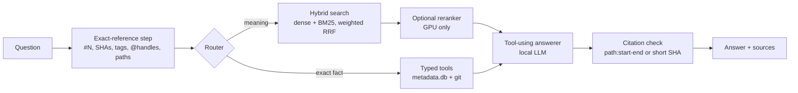

# repo-rag

Ask questions about a GitHub repository and get answers with citations. `repo-rag` indexes a
repo and answers five kinds of question:

- **Architecture:** "How does auth flow from the API layer to the DB?"
- **Code:** "What does `resolve_dependencies()` do and who calls it?"
- **Bug report to past fix:** find earlier commits that fixed a similar bug.
- **History, people, PRs, issues, releases:** "Who merged #1234?", "What changed between v2.30 and v2.31?"
- **Onboarding:** answers from the README, docs, CI and dependency files.

What sets it apart is **AST-based chunking** (tree-sitter): functions, methods and classes stay
whole instead of being cut at a character count. Exact questions (who, when, how many, `#N`) are
answered from tool output, never from the model's memory.

Only **open-source local models** are used. Nothing needs an Anthropic or OpenAI key.

Every number below comes from this repository's own eval harness
([`eval/RESULTS.md`](eval/RESULTS.md), [`docs/PROJECT_LOG.md`](docs/PROJECT_LOG.md)), with its
limits stated next to it. Almost all of it is one repository, `psf/requests`.

## At a glance

| | |
|---|---|
| Answer model | `Qwen3.8-27B` (AWQ 4-bit) served by vLLM on a Colab A100 40 GB, with CUDA graphs and MTP |
| Speed | about 4 s per question (was about 23 s before CUDA graphs and MTP) |
| Code questions | 39/40 |
| Docs questions | 11/12 |
| Exact facts through the model | 59/60 |
| Architecture questions | 13/15 (original set), 8/10 (fresh set) |
| Bug report to fix commit | requests 76 to 78/113 (about 68%), three identical runs; Flask 105/136 (77%), two identical runs. The weak spot: treat answers as leads to check |

These are mechanical pass rates from single runs, on one repository. See
[Measured results](#measured-results) for what each one does and does not show.

## How it works



- **Questions about meaning** go to hybrid search over code, docs, commits, PRs and issues:
  Qwen3 embeddings fused with BM25 by weighted reciprocal-rank fusion, always filtered by repo.
- **Exact questions** go to typed, parametrized tools over `metadata.db` (SQLite) and git. The
  model never writes SQL and never estimates names, dates or counts: it quotes tool output.
- **Every answer is checked.** Citations (`path:start-end` for code, short SHA for commits) are
  validated against what the tools actually returned; invalid ones are removed and unverified
  commit ids are flagged in the UI.

### Where the work runs

| Where | What |
|---|---|
| Laptop (CPU, no GPU needed) | Retrieval, tools, citation check, API, Streamlit UI |
| Colab A100 40 GB | Indexing (embedding is about 0.16 chunks/s on a laptop CPU) and the answer model |

The 27B model leaves no room on the card for a reranker, so the default setup runs without one.

Indexes move between machines as plain data (`export-index` / `import-index`), not Chroma
files. The answer model is served from Colab over a hash-checked Cloudflare tunnel; prompts cross
a public tunnel, so use it with **public repositories only**. The API has no authentication:
run it on localhost.

## Quickstart

```bash
uv sync
cp .env.example .env    # set GITHUB_TOKEN for PR/issue sync; never commit .env
uv run repo-rag --help
uv run pytest -q        # offline suite; network tests are deselected
```

Index a repository on a GPU, then use it on the laptop:

1. Open `notebooks/index_on_colab.ipynb` in Colab (A100), set the repo, run it, and download the zip.
2. Import it:

```bash
uv run repo-rag import-index repo_rag_index.zip
```

3. Search without any LLM:

```bash
uv run repo-rag search "where are retries configured" --repo psf/requests
```

4. For answers, start the model server with `notebooks/serve_model_27b_on_colab.ipynb` (it
   releases the GPU after 10 idle minutes), then start the API and UI and paste the URL and token:

```bash
uv run uvicorn repo_rag.api.server:app --reload
uv run streamlit run src/repo_rag/ui/app.py
```

Later, bring an indexed repo up to its latest commit. Chunks whose text did not change keep their
vectors (even if they moved to other lines); `--dry-run` shows how many would be embedded first, and
embedding more than 200 chunks on this machine needs `--yes` (use Colab for big updates):

```bash
uv run repo-rag update <owner/repo> --dry-run
uv run repo-rag update <owner/repo>
```

PR and issue data for the exact-fact tools:

```bash
uv run repo-rag sync-github <owner/repo> --max-prs 100000 --max-issues 100000
```

More commands (symbols, callers, summaries, history, eval runs) are listed in [CLAUDE.md](CLAUDE.md).

## Measured results

"Exploratory" means no pre-registered gate and a single repository. Read the caveats before
quoting any number.

### End-to-end agent check on psf/requests (27B, exploratory)

128 questions through the real agent, answer model `Qwen3.8-27B` with CUDA graphs and MTP, single
runs. A question passes when the answer cites lines (or names a commit) that match the known
answer, or abstains when it should.

| Question type | Pass |
|---|---:|
| Code (40) | 39/40 |
| Docs (12) | 11/12 |
| Architecture, original set (15) | 13/15 |
| Architecture, fresh set (10) | 8/10 |
| History (11) | 11/11 |
| References `#N` (10) | 10/10 |
| Kind of `#N` (5) | 5/5 |
| Issue to fixing PR (10) | 10/10 |
| Out-of-scope probes (5) | 5/5 (correctly abstained) |
| **Bug report to fix commit (10)** | **5/10** (old small set, before the commit changes below) |
| **Bug report to fix commit (113)** | **76, 76 and 78/113** (about 68%) in three identical runs of the default prompt `commit_explain`; the earlier prompt scored 74/113, and 57/113 was before the shortlist and tool-call changes. See [Commit questions](#commit-questions-what-was-tried) |

Caveats:

- **Architecture** passes when the answer names at least half of the gold files, so it is a
  proxy for answer quality. The labels were reviewed by the repository owner (provenance not
  independently verified), and the fresh set has no margin over its gate.
- **Run-to-run movement** is about one question per set: the same questions scored 12/15 with CUDA
  graphs alone and 13/15 with graphs plus MTP, and one code question flipped between runs. Do not
  read differences of one question as gains.
- **Commit questions** are the weak spot. On the 113 test pairs of psf/requests the answer
  model scores about 68% (three identical runs: 76, 76 and 78), so run-to-run noise is about two
  questions. A shortlist of 15 commits (the first 5 in full) and 6 tool calls raised it from
  57/113. Of 35 misses, 23 never had the gold commit among the 15 commits the model saw: the main
  loss is retrieval, not the model's choice. Treat answers to "which past commit fixed this?" as
  leads, not conclusions.
- There is no fallback model. The previous model, `Qwen2.5-Coder-14B-Instruct`, scored code
  36/40, docs 10/12 and commit 3/10 under older limits; it was not re-measured under the current
  defaults and is unsupported.

### Exact facts through the agent

60 auto-generated facts on encode/httpx (expected answers from the raw GitHub data and plain git):
**60/60** through the tools alone, and **59/60 (98.3%)** through the 27B model (target 90%). The
one miss is a month-count question where the model used a different tool than the one scoring
expects. This scores routing among the exact tools, not retrieval.

### Manual check of 32 open-ended questions

A 32-question set covering architecture, code, history, people, PRs, releases and bug reports was
run on the 27B. The automatic citation checks flagged 1 of 32 (a PR-review question the data
cannot answer). Those checks do not test correctness, so an AI reader also compared the 19
exact-fact answers with git and `metadata.db`: 5 were wrong at first (path-based counts that
ignored renamed files, an issue question answered from a few hits, and a release question), 4
were fixed and the fifth, a vague "redirect change in v2.3" question, still gets a weak answer.
The code and docs answers in this set were checked only by the automatic citation checks, and no
human labelled any of it. Details: [docs/PROJECT_LOG.md](docs/PROJECT_LOG.md).

### Claude's review of the 27B answers

An AI reader (Claude, not a person) read the 27B's saved answers against the cited code, the pinned
source, git and `metadata.db`. Verdicts are in `eval/claude_review_27b/`.

| Answers read | Result |
|---|---|
| Code (40) and docs (12), one guards-on run | 49/52 correct, 3 partial; 50/52 faithful. The mechanical score said 40/40 and 11/12. The worst: the "no charset" questions say text falls back to charset detection, but `text/*` pages default to ISO-8859-1 |
| Exact facts, 15 answers of the 32-question set | 10 fully right, 4 partial (history lists titles only, "who knows it best" ignores recency, a PR answer that is a bare number, a release summary that skips the security fix), 1 right abstention with misleading wording |
| Commit questions (113) | 70 pass by exact SHA; about 76 if 6 answers that are valid alternative fixes are counted. 67 of the 70 passes are a bare SHA with no explanation. One answer names the commit that introduced the bug as its fix |

This is one reader and no human labels, on questions the system was tuned on.

### Fresh questions and the commit-explanation prompt (2026-11-19, 27B, single runs)

| Run | Result |
|---|---|
| 73 new questions (written after the tuned sets), shipped prompt, three runs | 72/73 each time, no question changed between runs |
| Same questions with the answer guards on | 72/73, identical (no measured gain; the set is at its ceiling) |
| Bug report to fix commit (113), default prompt | 74/113; 86 of 99 answers are a bare SHA |
| Same, `commit_explain` prompt (the default since 2026-11-20) | 78/113; every answer says why the commit matches |
| The 103 tuned questions | code 40/40, docs 11/12, history 11/11, refs 10/10, kind 5/5, commit 7/10, probes 5/5 |

The fresh questions were written by an AI and are easy for this system, so they show it does not
regress, not how strong it is. `commit_explain` makes more specific claims that have not been
checked against the diffs. Re-run under `commit_explain` on 2026-11-20 against the previous
default: the 103 tuned questions 98 against 99 (one code question, a bug-style report, was
answered with a commit instead of code), the 72 fresh questions 72 against 72, architecture 13/15
against 12/15 and 9/10 against 9/10. No regression beyond noise.

### Commit questions: what was tried

Bug report to its own fix commit, 27B, single runs, one gold commit per question. Run-to-run
noise is about two questions (identical controls: 76, 76, 78 of 113), so only the larger moves
below mean anything, and none of the gains is significant on its own (sign test).

| Setting | requests (113) | Flask (136) |
|---|---:|---:|
| Default prompt `commit_explain`, identical runs | 76, 76, 78 | 105, 105 |
| Search with the model's query and the question merged (`fused`) | 79 | 105 |
| Summary index for search, fused, summary hidden from the model | 82 and 84 | 110 and 110 |
| Model must read candidates with `get_commit` before naming one (`verify`) | 69 (worse, p = 0.065) | not run |

- **Summary index:** the 27B wrote a short plain-English summary of every commit; it is added to the
  text that is *searched*, and the model still sees the raw commit. Retrieval alone (hybrid, 170
  Flask queries over 3,829 commits): hit@1 93 to 99, hit@5 141 to 146, MRR 0.675 to 0.712. Showing
  the summary to the model did not help (72/113 against 78/113), so it is hidden.
- **Flask result (re-run 2026-11-20 after a crash fix):** an earlier Flask run was understated because
  the PR-search tool raised an error on a repo indexed without PR data (now fixed; it returns a note).
  With the fix, the two identical controls score 105 and 105 of 136 and agree on every question. The
  summary index scores 110 twice: ahead on 14 questions, behind on 9 (sign test p = 0.405), so it is
  not significant. It also abstains less (14 against 19), so part of the gain is answering more often.
  Fused queries alone: 105, no change.
- **Why the 31 Flask misses fail** (first query replayed against the index): the gold commit was in the
  top 5 for 6, at rank 6 to 15 for 5, at rank 16 to 30 for 8, and not in the top 30 for 12. So 25 of
  31 are a retrieval miss. 19 of the 31 are abstentions. Several gold commits are one-line typo, docs
  or packaging fixes whose message says little ("Fixes #1051"), and four questions share one gold
  commit (top-level arrays in `jsonify`) while the model often names a sibling commit that looks like
  the right fix. Some of the misses are therefore label ambiguity, not wrong answers.
- **Reading before naming made answers worse** on requests, so it stays off.
- **Rejected on purpose:** a reranker (no gain, slower), and adding issue or PR text to the search
  text (the gold commit's own issue text would leak the answer). A run restricted to fix-like
  commits scored 85/113, but every gold commit passes that filter by construction, so it is an
  upper bound, not a result.
- **Not the default:** the summary index needs a 27B summary pass plus a GPU embedding run for each
  repository. Requests shows +4 to +8 over the controls; Flask shows +5 but not significantly. It is not proven. Turn it on
  with `agent_commit_query=fused` and `agent_commit_hide_summary=true`; the build steps are in
  [docs/FLASK_COMMIT_RUNBOOK.md](docs/FLASK_COMMIT_RUNBOOK.md).
- **Limits:** the questions are an issue and its own fix commit, not "find a similar past fix for
  an unseen bug"; every gold commit has a fix-like message; the issue text is not part of the
  question. About 9 gold commits have terse or non-code messages that no search can match.

### Speed

Mean time per question fell from about 23 s to 4.2 s on the same A100 (103 non-architecture
questions). The cost was almost all decoding: eager mode produced about 7 tokens/s, CUDA graphs
about 35, and CUDA graphs with MTP about 45 to 52. The Cloudflare tunnel adds about 0.3 to
0.6 s per call, and the first question in a process pays about 20 s of laptop warm-up.

### AST chunking: more complete evidence, not a consistent ranking gain

Exact dense search, headers on, 40 questions per repo, fraction of gold line ranges that
reach 90% coverage in the top 10 ("Gold >=90%@10"):

| Repo | Character chunks | Language-aware splitter | AST (ours) |
|---|---:|---:|---:|
| psf/requests | 0.654 | 0.625 | **0.842** |
| expressjs/express | 0.725 | 0.725 | **0.825** |

AST minus character, headers on, all questions: +0.188 [+0.085, +0.292] on Requests and +0.100
[+0.000, +0.225] on Express (paired bootstrap, 95% CI). Ranking (MRR@10) is **not** consistently
better, and in some hybrid settings it is worse (Requests -0.074 [-0.137, -0.017]). The reference
`astchunk` library matches our completeness on Requests (0.842 both), so this does not show an
advantage over reference cAST. Python and JavaScript only; two repos.

### Embedding model

`Qwen/Qwen3-Embedding-0.6B` at 512 dimensions, chosen by comparing it with a 7B code embedder,
CodeRankEmbed and BM25 (nDCG@10):

| Task | Qwen3-0.6B @512d | nomic-embed-code 7B | BM25 |
|---|---:|---:|---:|
| Questions about code (36) | 0.738 | 0.431 | 0.522 |
| Bug report to fix commit (144) | 0.482 | 0.596 | 0.347 |

The 7B model wins bug-to-fix but would need a GPU at query time and a much larger index, so it
was not adopted. Filtering retrieval by repo adds 0.13 to 0.18 nDCG@10 for every model.

### Reranking (opt-in, GPU only)

- **Code**: `Qwen3-Reranker-8B` beat the 4B on 150 questions: MRR 0.860 to 0.926 (+0.066
  [+0.026, +0.109]), at about +45% latency.
- **Bug report to fix commit**, held-out retrieval test, 8B rerank at depth 50:

| Repo | n | Hit@5 | MRR@10 |
|---|---:|---:|---:|
| psf/requests | 113 | 0.858 | 0.770 |
| pallets/flask | 136 | 0.978 | 0.933 |
| fastapi/fastapi (via PR links) | 14 | 0.857 | 0.857 |
| all | 263 | 0.920 | 0.859 |

Without reranking, source-path Hit@5 is 0.779 (requests 0.689, flask 0.850). The gold here is
link-derived (an issue's own fix commit), so this does not measure how useful *similar* past
fixes are to a developer. The 27B setup does not use the reranker, so the agent's
commit score above (about 68% on requests) is far below this retrieval score.

## Known limits

- **One main repository.** Almost every number is from `psf/requests` (plus httpx for exact
  facts, Flask and FastAPI for commit search). Other languages, larger repos and ANN accuracy at
  scale are unmeasured.
- **No independent human labels.** The architecture labels were reviewed by the owner only (the
  Flask labels were not checked against source), and answer quality was judged by automatic
  checks and AI readers, not people. The review of the 27B's answers above is one AI reader.
- **Commit answers can be wrong with confidence.** Since 2026-11-20 each answer says why the
  commit matches, but about a third of bug reports still end in a wrong commit or an abstention.
  Some wrong picks are a different, plausible fix of the same issue.
- **History counts exclude merge commits** (4,883 of 6,495 for requests), by design; answers do not
  say so.
- **Chunk granularity.** Merged chunks are labelled by their first symbol, so a question about the
  second function in a chunk can cite the whole chunk's range.
- **Architecture questions** can abstain when the top results stop at an entry point; the
  repo-map summaries are built but not enabled by default because the router lowered recall.
- **Extra answer guards are off by default.** Retry-on-abstain, retry-on-tool-error, citation
  snapping and the `history_grounded` prompt held every regression gate when switched on, but
  adopting them is undecided.
- **Colab dependency.** The 27B needs a 40 GB GPU. Colab releases it after 10 idle minutes and
  the tunnel then stops answering until the server notebook is restarted.
- "Who pushed" is not in git: answers report author, committer and `merged_by`.
- Answers show names and GitHub handles, never author emails.
- Whole-repo scan questions ("any dead code?") are based on the top results and not exhaustive.

## Repository layout

```
src/repo_rag/
  chunking/    tree-sitter chunker, docs chunker, symbol table
  ingest/      clone, file walk, indexer
  history/     commits, GitHub PR/issue sync, metadata.db, git tools
  store/       Chroma collections, BM25, embeddings, index export/import
  retrieval/   hybrid retriever, exact-reference detection, reranker
  agent/       LangGraph agent, tools, prompts, citation check, remote model client
  api/         FastAPI: GET /repos, POST /ask (streaming), POST /repos/import
  ui/          Streamlit chat UI with source links at the indexed commit
eval/          datasets, runners and current results
experiments/   archived experiment code, tests and result files
notebooks/     generated Colab notebooks (indexing, model server)
```

## More

- [plan.md](plan.md): roadmap and phase status
- [CLAUDE.md](CLAUDE.md): conventions and the full command list
- [docs/HANDOFF.md](docs/HANDOFF.md) and [docs/PROJECT_LOG.md](docs/PROJECT_LOG.md): current
  status, decisions and the evidence behind them
- [eval/RESULTS.md](eval/RESULTS.md): the benchmark write-ups
